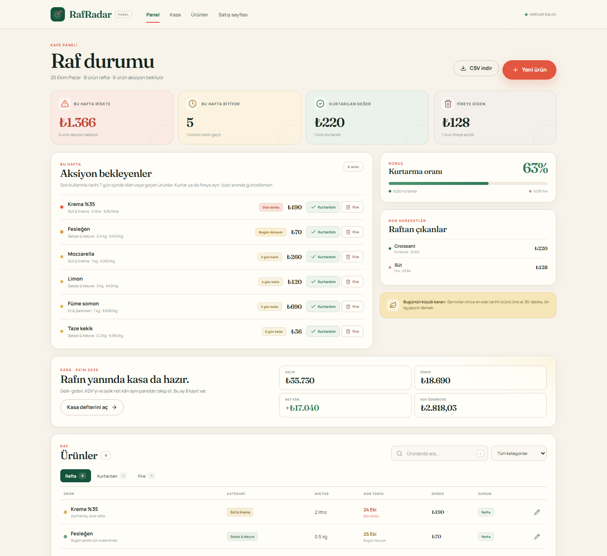

# RafRadar

**Kafeler için son kullanma ve fire takibi.**  
Rafındaki ürünün tarihini ve parasını görünür kılar: bu hafta riskte olanı gör,
indirimle kurtar, fireyi TL olarak ölç.



> 3-15 kişilik bağımsız kafeler ve pastaneler için. Pro plan **299 TL/ay**.
> 14 gün ücretsiz, kredi kartı yok.

## Neden var?

Küçük kafelerde fire çoğu zaman Excel’de, WhatsApp’ta veya kafada tutulur. Muhasebe
programları bu iş için fazla büyük, POS’lar rafın arkasındaki tarihi göstermez. Sonuç:
ay sonunda görünmeyen bir TL kaybı.

RafRadar tek bir işi iyi yapar:

> Ürünü 10 saniyede ekle → 7 günlük riski ve TL karşılığını gör → kurtar veya fireye
> ayır → özet anında güncellensin.

## Hızlı başlangıç

Gereksinim: **Node.js 24+** (yerleşik `node:sqlite` kullanılır) ve npm.

```bash
npm install
npm run dev
```

- Satış sayfası: **http://localhost:5174**
- Ürün paneli: **http://localhost:5174/app**
- API: **http://localhost:4000/api/health**

İlk açılışta pano **boştur**; boş ekrandaki “İlk ürünü ekle” veya “Örnek 10 ürünle
keşfet” ile başlanır. Veri `api/data/rafradar.db` dosyasında kalıcıdır.

### Diğer komutlar

```bash
npm run demo       # 10 örnek ürün ekle (pano boşsa)
npm run reset      # tüm ürünleri sil
npm run test:api   # API duman testleri (geçici DB, gerçek panoya dokunmaz)
npm run build      # tip kontrolü + üretim derlemesi
```

Tek tek çalıştırma: `npm run dev:api`, `npm run dev:web`.

## Ürün

### Satış sayfası (`/`)

Tek cümlelik değer önerisi → problem → gerçek ürün ekranı → 3 fayda → örnek ROI →
3 fiyat paketi → 6 itiraza SSS → CTA. Fiyatlar KDV dahil ve net; ödeme alınmıyor, bu
sayfada açıkça belirtiliyor.

### Panel (`/app`)

- **Ürün ekle/düzenle/sil:** ad, kategori, miktar + birim, birim maliyet, son tarih, not.
- **Risk paneli:** 7 gün içinde bitecek veya tarihi geçmiş ürünler, kalan gün ve TL değeri.
- **Kurtardım / Fire:** tek tıkla sonuç; özet, kurtarma oranı ve son hareketler güncellenir.
- **Rafa geri al:** yanlış işaretlenen ürün tekrar aktif olur.
- **Arama + kategori + durum sekmeleri.**
- **CSV dışa aktarma.**
- **Boş / yükleniyor / hata** durumları; boş panoda ilk adım ve demo.
- **Klavye:** `N` yeni ürün, `/` arama, `Esc` modal kapat.
- **Mobil:** 390px’te tablo kart görünümüne döner, yatay taşma yok.

## Teknoloji seçimleri ve gerekçeleri

| Katman | Seçim | Neden? |
| --- | --- | --- |
| API | **Express 4 + TypeScript** | En tanıdık, en az sürprizli HTTP katmanı. Rotalar ve hata zarfı tek yerde. |
| Doğrulama | **zod** | Alan bazlı, okunabilir Türkçe hata mesajları; `safeParse` ile 400 ayrımı net. |
| Veritabanı | **node:sqlite (SQLite/WAL)** | Tek dosya, sunucu yok, Docker yok. “Gerçek kalıcı veri” şartını en kısa yoldan karşılar. Prisma’nın şema/CLI yükü 60 dakikada gereksiz risk. |
| Web | **Vite + React 18 + TypeScript** | Satış sayfası ve panel aynı projede iki rota. Hızlı HMR, küçük kurulum. |
| Rotalar | **React Router** | `/` ve `/app` ayrımı; satış sayfası ayrı proje değil. |
| Veri çekme | **TanStack Query** | Loading/error/cache/invalidation tek yerde; mutation sonrası özet tazelenir. |
| Stil | **El yazımı CSS** | Krem–orman–domates editoryal yönü; jenerik Tailwind/shadcn görünümünden kaçınmak. Tek tasarım dosyası, tutarlı tokenlar. |
| Çalıştırma | **npm workspaces + concurrently** | Kökte `npm run dev` → iki proje birlikte. |

**Almadığım kararlar:** Next.js (bu ölçekte Vite yeterli ve daha hızlı), Prisma
(tek tablo için gereksiz), ödeme entegrasyonu (rubrik istemiyor, zaman riski), auth
(tek kullanıcı varsayımı serbest), grafik kütüphanesi (sayı + bar yeterli), Tailwind
(tasarım yönünü özgün tutmak için).

## Klasör yapısı

```
rafradar/
├── api/
│   └── src/
│       ├── index.ts    rotalar, zod, hata zarfı
│       ├── db.ts       şema, CRUD, dashboard, demo, CSV
│       ├── env.ts      .env yükleme, port/DB yolu
│       ├── demo.ts     örnek veri scripti
│       ├── reset.ts    temizleme scripti
│       └── smoke.ts    duman testleri
├── web/
│   └── src/
│       ├── landing/    satış sayfası (/)
│       ├── product/    ürün paneli (/app), modal, boş durum
│       ├── components/ logo, toast
│       ├── hooks/      mutation katmanı
│       ├── api.ts      tipli fetch istemcisi
│       ├── utils.ts    TL/tarih/Türkçe arama
│       └── styles.css  tasarım sistemi
├── docs/
│   ├── PLAN.md         kapsam + YAPMAYACAKLARIM
│   ├── PITCH.md        90 saniyelik metin
│   └── KABUL.md        22 maddelik kontrol
├── .env.example
└── package.json
```

## API özeti

| Metot | Yol | İş |
| --- | --- | --- |
| GET | `/api/dashboard` | özet + aksiyon + son hareketler + ürünler |
| GET | `/api/items?status=&q=&category=` | filtreli liste |
| POST | `/api/items` | 201 · yeni ürün |
| PATCH | `/api/items/:id` | 200 · kısmi güncelleme |
| DELETE | `/api/items/:id` | 204 |
| POST | `/api/items/:id/rescue` | kurtarıldı |
| POST | `/api/items/:id/waste` | fire |
| POST | `/api/items/:id/reopen` | rafa geri al |
| POST | `/api/demo` | boş panoya örnek veri |
| GET | `/api/items/export.csv` | CSV |

Hatalar: `{ "error": { "code": "VALIDATION_ERROR", "message": "...", "field": "..." } }`.

## Ortam değişkenleri

```bash
cp .env.example .env       # Windows: copy .env.example .env
```

| Değişken | Varsayılan | Açıklama |
| --- | --- | --- |
| `API_PORT` | `4000` | Express portu |
| `WEB_PORT` | `5174` | Vite portu |
| `DB_PATH` | `api/data/rafradar.db` | SQLite dosyası (köke göre) |

`.env` git’e girmez; `.env.example` girer. Kodda gömülü anahtar yoktur. Gerçek ürün
e-posta servisi eklenecekse anahtar yalnız `.env`’e konur (bu demoda kullanılmıyor).

## Doğrulama

- `npm run test:api` → **9/9** (CRUD, risk toplamı, kurtarma/fire, demo, CSV).
- HTTP sözleşme → **17/17** (400/404, alan hataları, bozuk JSON, Türkçe arama, CSV).
- Tarayıcı ürün akışı → **13/13** (sıfır veri, hatalı form, ekleme, N, kurtarma,
  sekmeler, yenileme, arama, düzenleme, silme, mobil, konsol).
- Tarayıcı demo/fire/mobil/hata → **5/5**.
- SQLite kapat-aç → ürün ve risk toplamı yerinde.
- `npm run build` → başarılı.

## Ajanı nasıl sürdüm?

1. **Fikri ve fiyatı ben kilitledim.** “Kafe için stok uygulaması” gibi geniş bir
   alan yerine 3-15 kişilik bağımsız kafelerin son kullanma/fire acısını seçtim.
2. **Önce kapsamı kestim.** `docs/PLAN.md` içindeki YAPMAYACAKLARIM listesiyle auth,
   ödeme, çoklu şube, POS ve bildirimleri dışarıda bıraktım. Ajanın “bir de şunu
   ekleyelim” refleksini bu listeyle frenledim.
3. **Tek dikey dilim istedim.** Önce ürün ekleme → API → dashboard → kurtarma akışı
   çalıştı; satış sayfası sonra geldi.
4. **Doğrulamayı önce kurdum.** Boş ad, negatif miktar, geçersiz takvim tarihi ve bozuk
   JSON için testleri yazdım; UI bunları alan uyarısına çeviriyor.
5. **Ürünü yabancı gibi kullandım.** Puppeteer ile sıfır veri, yanlış form, kaydet,
   yenile, kurtar, fire, sil, mobil ve API kapalı senaryolarını koşturdum.
6. **Görsel geri bildirimle düzelttim.** Ekran görüntüsünde footer’ın sıkıştığını ve
   SSS başlığının üç satıra bölündüğünü görüp düzelttim; fiyat tablosunda üç paketi ve
   “en çok tercih edilen” etiketini netleştirdim.
7. **Abartı eklemedim.** Olmayan özelliği satmadım: ödeme alınmadığını, faturalandırmanın
   demo olduğunu sayfada açıkça yazdım.

## Bilinen sınırlar

- Tek kullanıcı; giriş yok (yarışma kapsamı gereği).
- Ödeme/fatura yok; fiyatlandırma satış sayfasında, CTA ürünü açıyor.
- Çoklu şube, POS ve barkod yok.
- Demo verisi yalnız boş panoya yüklenir; `npm run reset` ile temizlenir.

## Lisans

MIT — bkz. [LICENSE](LICENSE).
